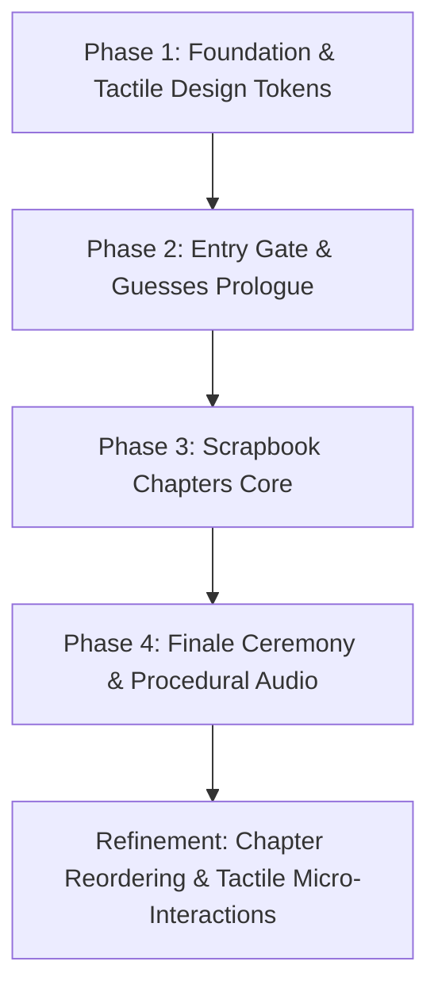

# 📖 Birthday Storybook: Architecture, Chapters & Design Guide

> **Target Audience**: Planning & Designing AI Agents, Frontend Architects, and Visual Designers  
> **Project**: Handcrafted Tactile Birthday Storybook for **Kritika ("Lucky")** (Birthday: 16th October)  
> **Tech Stack**: Vanilla HTML5, Vanilla CSS3 (Custom Properties & Tokens), ES6+ JavaScript, GSAP 3.12 (with Draggable & Timeline), Web Audio API (Procedural Synthesizer), JSON-driven content store  
> **Design Philosophy**: Anti-Template, Tactile Scrapbook, Organic Asymmetry, Mobile-First (360px–430px)

---

## 📑 Table of Contents
1. [Core Creative Vision & Aesthetics](#1-core-creative-vision--aesthetics)
2. [Project Phases & Implementation Progression](#2-project-phases--implementation-progression)
3. [Chapter-by-Chapter Breakdown (Chapters 0 to 6)](#3-chapter-by-chapter-breakdown)
   - [Chapter 0: Cover Gate](#chapter-0-cover-gate-the-sealed-diary)
   - [Chapter 1: Let Me Guess…](#chapter-1-let-me-guess-interactive-deductions)
   - [Chapter 2: Parents](#chapter-2-parents-mom--daddy-vintage-album)
   - [Chapter 3: The OG Opp](#chapter-3-the-og-opp-sisters-wanted-poster--banter)
   - [Chapter 4: Cousins](#chapter-4-cousins-snapshots--air-mail-modal)
   - [Chapter 5: Friends](#chapter-5-friends-corkboard-lightbox--memory-jar)
   - [Chapter 6: Wish! 🎂](#chapter-6-wish--realistic-vibrant-cake--closing-note)
4. [Tactile Design System & Token Specifications](#4-tactile-design-system--token-specifications)
5. [Procedural Audio & Tactile SFX Engine](#5-procedural-audio--tactile-sfx-engine)
6. [Data Contract & Content Architecture](#6-data-contract--content-architecture)
7. [Guidance & Rules for Planning & Designing Agents](#7-guidance--rules-for-planning--designing-agents)

---

## 1. Core Creative Vision & Aesthetics

This project is a bespoke, private digital birthday gift for **Kritika** (fondly called **"Lucky"**), who had to postpone her birthday celebration due to being unwell. 

### Key Tenets for Designers and Planners:
* **Anti-Template Philosophy**: Standard flat UI cards, corporate gradients, and symmetrical SaaS layouts are strictly prohibited. The website must feel like a physical, handcrafted scrapbook personal diary assembled with paper, tape, scissors, Polaroid prints, and dried leaves.
* **Organic Asymmetry**: Elements intentionally lean at wobbly angles (`-6°` to `+6°`). Stickers, washi tape strips, and photo corners hold items onto warm, textured paper backgrounds (`#FFFDF8`, `#FAF5ED`).
* **Tactile Interactions**: Every click or tap has a physical real-world equivalent: breaking a wax seal, stamping rubber ink, peeling washi tape, opening an airmail envelope, reaching into a glass jar, flipping a Polaroid in 3D, and blowing out birthday candles with realistic smoke puffs.
* **Warm, Comforting Atmosphere**: Soft music-box arpeggios, gentle paper rustles, pastel tones (blush pink, creamy vanilla, sage green, lavender, butter yellow), and soothing handwritten typography (`Caveat`, `Gaegu`, `Permanent Marker`, `Lora`).

---

## 2. Project Phases & Implementation Progression

The application was built systematically across 4 strategic phases, followed by a dedicated UX refinement pass:



### Phase 1: Foundation, Tactile Design System & Content Architecture
* **Objective**: Build the application skeleton without external bundler lock-in, define design tokens, procedural SVG paper grain, procedural Web Audio engine, and the book stage navigation engine.
* **Deliverables**:
  - `tokens.css`: Color palette (Rose, Blush, Cream, Sage, Butter, Charcoal Ink), radii, shadows, and easing functions.
  - `typography.css`: Google Fonts integration (`Caveat`, `Gaegu`, `Permanent Marker`, `Courier Prime`, `Lora`, `Outfit`).
  - `scrapbook.css`: Paper grain overlays, washi tape strip variants, photo corners, tilt utility classes (`.tilt-neg-1` through `.tilt-pos-3`).
  - `audio-player.js`: Zero-asset Web Audio API music-box pentatonic synthesizer with procedural paper rustle, sticker pop, page turn, and candle blowout white-noise filters.
  - `book-stage.js`: Chapter slide transitions, bookmark ribbon navigation, touch swipe support, and unlock progression state in `sessionStorage`.
  - `data/content.json` & `content-loader.js`: Modular JSON data architecture with offline fallback.

### Phase 2: The Portal — Entry Gate & "Let Me Guess..." Prologue
* **Objective**: Create the personalized mystery entrance and playful deduction sequence.
* **Deliverables**:
  - `gate.js` & `gate.css`: Sealed diary cover requiring name (`"Kritika"` / `"Lucky"`) and birthday (`16th October`) with witty hint post-its and wax seal break animation.
  - `guess.js` & `guess.css`: 5 deduction flashcards probing her passions (dancing, painting, cakes, blankets), rubber stamp animations (`KNEW IT! ✨`, `DENIAL! 😜`), and celebratory confetti burst.

### Phase 3: The Scrapbook Chapters Core
* **Objective**: Assemble the personal memory chapters from friends, family, sister, and cousins.
* **Deliverables**:
  - Vintage album styling with heirloom photo corners.
  - Playful wanted poster zine layout.
  - Vintage airmail envelopes with postal cancellation stamps.
  - Draggable/flippable Polaroid corkboard.

### Phase 4: Make a Wish Finale, Audio Polishing & Launch Readiness
* **Objective**: Build the celebratory candle ceremony, responsive QA, and unlisted privacy protection.
* **Deliverables**:
  - `finale.js` & `finale.css`: Interactive cake with flickering candle flames, puff blowout, and Prem's closing letter.
  - `robots.txt` (`Disallow: /`) and social OpenGraph tags.
  - Standalone preview server (`serve.js`).

### Refinement Pass: Chapter Reordering & Rich Tactile Overhaul
* **Objective**: Reorder the story to follow a natural emotional crescendo and implement high-tactile components requested by user feedback:
  - Sequence reordered: **Cover → Guesses → Parents → OG Opp → Cousins → Friends → Wish**.
  - **Parents** renamed with dedicated Mom & Daddy cards.
  - **OG Opp** dedicated exclusively to her sister with peelable washi tape confession.
  - **Cousins** transformed into individual photo cards opening a centered **Air Mail letter modal**.
  - **Friends** expanded to **8 enlarged photocards** (no "tap to flip" text) with centered **lightbox focus & 3D flip**, plus an **illustrated glass jar with animated hand reaching in** to draw memories.
  - **Wish** upgraded with a **realistic, vibrant multi-tier artisanal cake** with fresh strawberries, glossy drips, and candlelight glow aura.

---

## 3. Chapter-by-Chapter Breakdown

### Chapter 0: Cover Gate ("The Sealed Diary")
* **Mount ID**: `#chapter-0` (`data-chapter="gate"`)
* **Controller**: [`js/gate.js`](file:///c:/Users/premn/birthday_present/js/gate.js) | **Styles**: [`css/gate.css`](file:///c:/Users/premn/birthday_present/css/gate.css)
* **Narrative Arc**: Mystery & Personalization. Before entering, the visitor proves she is the intended recipient.
* **Components & Visual Design**:
  - Handcrafted leather/cloth journal texture with stitched spine seam.
  - Handwritten input line for Name/Nickname (case-insensitive validation for `"Kritika"`, `"Lucky"`, `"Kriti"`, `"Kittu"`).
  - Vintage day and month selector tabs for her birthday (`16th October`).
  - **3D Wax Seal Button**: Crimson embossed wax ring with a gold star (`✦ OPEN`) that melts and cracks when pressed with a pop sound (`playStickerPop()`).
  - **Sticky Note Hints**: If inputs are incorrect, a wobbly yellow Post-it note floats down with playful hints (*"That's definitely you, but check the birthday again! Psst... it's in October 😉"*).
* **Navigation Outcome**: Unlocks Chapter 1 and turns page forward.

---

### Chapter 1: Let Me Guess… ("Interactive Deductions")
* **Mount ID**: `#chapter-1` (`data-chapter="guess"`)
* **Controller**: [`js/guess.js`](file:///c:/Users/premn/birthday_present/js/guess.js) | **Styles**: [`css/guess.css`](file:///c:/Users/premn/birthday_present/css/guess.css)
* **Narrative Arc**: Playful Warm-up. Proves we know her quirky habits before revealing the celebration.
* **Components & Visual Design**:
  - Progress tracker with 5 cute step dots.
  - 5 Staggered flashcards held by alternating washi tapes (pink, sage, lavender, butter).
  - Cards probe her traits:
    1. *Cozy Vibe*: Bundled up in a blanket sipping tea.
    2. *Artist Soul*: Paint streaks on fingers or sketchbook.
    3. *Sweet Tooth*: Scheduling 3 cake tastings this week.
    4. *Dancer Mode*: Solo dance concerts in the room when music hits.
    5. *Surprise!*: Wondering if anyone remembered her belated celebration.
  - **Reaction Stamps**: Tapping "Yes, spot on! 🙈" or "Nope, false! 😂" stamps rubber-inked badges (*"KNEW IT! ✨"*, *"DENIAL! 😜"*, *"WE HAVE PROOF 📸"*).
  - **Reveal Card & Confetti**: After card 5, paper confetti showers down and a big reveal card appears with button *"Open Mom & Daddy's Letters →"*.
* **Navigation Outcome**: Unlocks Chapter 2 and navigates to Parents.

---

### Chapter 2: Parents ("Mom & Daddy Vintage Album")
* **Mount ID**: `#chapter-2` (`data-chapter="parents"`)
* **Controller**: [`js/chapter-parents.js`](file:///c:/Users/premn/birthday_present/js/chapter-parents.js) | **Styles**: [`css/chapters.css`](file:///c:/Users/premn/birthday_present/css/chapters.css)
* **Narrative Arc**: Unconditional Love & Emotional Foundation.
* **Components & Visual Design**:
  - Two dedicated vintage heirloom cards for **Mom** and **Daddy**.
  - **Antique Brass Photo Corners**: Realistic 4-corner mounts holding each photo (`.corner-tl`, `.corner-tr`, `.corner-bl`, `.corner-br`).
  - Portrait badges with pastel inner glows (`👩‍👧` for Mom, `👨‍👧` for Daddy) and pressed botanical sprigs (`🌿`).
  - Heartfelt blessings typed in warm serif typography (`Lora`) with cursive sign-offs (*"With endless love ❤️"*).
  - Advance button: *"Turn to The OG Opp 💥 →"*.
* **Navigation Outcome**: Unlocks Chapter 3 and navigates to OG Opp.

---

### Chapter 3: The OG Opp ("Sister's Wanted Poster & Banter")
* **Mount ID**: `#chapter-3` (`data-chapter="og_opp"`)
* **Controller**: [`js/chapter-og-opp.js`](file:///c:/Users/premn/birthday_present/js/chapter-og-opp.js) | **Styles**: [`css/chapters.css`](file:///c:/Users/premn/birthday_present/css/chapters.css)
* **Narrative Arc**: Comic Relief & Sibling Bond. Dedicated exclusively to her sister.
* **Components & Visual Design**:
  - **Parody Wanted Poster**: Distressed parchment card with red dashed borders, tilted at `-2°`.
  - Case file badge: `CASE FILE #1016-OPP`.
  - Sister Polaroid frame: Snapshot labeled *"Roommates by blood, rivals by choice"* (`👯‍♀️`).
  - **Crimes Dossier**: Typewriter monospace list detailing:
    * Unauthorized borrowing of hoodies and scrunchies.
    * Eating 75% of the birthday cake frosting without remorse.
    * Midnight dance concerts in shared room.
    * Leaving unwashed watercolor brushes in drinking cups.
  - **Peelable Washi Tape Confession**: An interactive sage washi tape strip. Tapping it triggers a rustle sound, rotates the tape `18°`, and reveals her sister's secret note: *"Okay fine, I admit it! You might be annoying sometimes, but life would be so dreadfully boring without my favorite opponent... Best sister for life 💖"*.
  - Advance button: *"Turn to Cousin Air Mail ✈️ →"*.
* **Navigation Outcome**: Unlocks Chapter 4 and navigates to Cousins.

---

### Chapter 4: Cousins ("Snapshots & Air Mail Modal")
* **Mount ID**: `#chapter-4` (`data-chapter="cousins"`)
* **Controller**: [`js/chapter-cousins.js`](file:///c:/Users/premn/birthday_present/js/chapter-cousins.js) | **Styles**: [`css/chapters.css`](file:///c:/Users/premn/birthday_present/css/chapters.css)
* **Narrative Arc**: Distant Tribe & Shared Adventures.
* **Components & Visual Design**:
  - **2x2 Photo Gallery Grid**: Individual Polaroid snapshots for 4 cousins:
    1. **Aarav**: *"Vacation Partner"* (Goa beach trip `🏖️`)
    2. **Simran**: *"Choreo Queen"* (Sangeet dance practice `💃`)
    3. **Kabir**: *"Foodie Gang"* (Midnight pizza run `🍕`)
    4. **Diya**: *"Art Connoisseur"* (Pottery workshop `🎨`)
  - Cute floating badge on each snapshot: `✉️ Open Letter`.
  - **Air Mail Modal Overlay**: Clicking any cousin's snapshot opens an authentic Air Mail envelope modal:
    * Red and blue diagonal chevron stripes (*PAR AVION*).
    * Circular postmark stamp with date cancellation: `OCT 16`.
    * Unique postage stamp matching cousin's accent color.
    * Unfolded lined stationery sheet with personal handwriting and signoff.
    * Tactile `Close Letter ✕` button and backdrop dismissal.
  - Advance button: *"Turn to The Friends Corkboard 📸 →"*.
* **Navigation Outcome**: Unlocks Chapter 5 and navigates to Friends.

---

### Chapter 5: Friends ("Corkboard, Lightbox & Memory Jar")
* **Mount ID**: `#chapter-5` (`data-chapter="friends"`)
* **Controller**: [`js/chapter-friends.js`](file:///c:/Users/premn/birthday_present/js/chapter-friends.js) | **Styles**: [`css/chapters.css`](file:///c:/Users/premn/birthday_present/css/chapters.css)
* **Narrative Arc**: Everyday Laughs & Soul Circle.
* **Components & Visual Design**:
  - **8 Enlarged Photocards Grid**: High-contrast, clean Polaroid frames for Ananya, Rohan, Meera, Priya, Kabir, Sneha, Tanvi, and Arjun.
  - **Anti-clutter rule**: Removed all distracting "tap to flip" text from the main cards.
  - **Centered Lightbox Zoom & 3D Flip**: Tapping any card opens a 340px centered lightbox modal with backdrop blur. Tapping the enlarged card triggers a 3D flip (`transform: rotateY(180deg)`) revealing ruled stationery paper with their full message.
  - **Realistic Glass Memory Jar**:
    * Rendered mason jar with cork stopper, twine string, and kraft tag (`Memories ✨`).
    * Semi-transparent cylindrical glass reflections and highlights (`.glass-shine-left`, `.glass-shine-right`).
    * Multiple pastel colored paper slips (`.paper-slip`) visible inside the glass.
  - **Animated Reaching Hand**:
    * When the jar is tapped, an SVG illustrated sleeve and hand reaches down into the jar neck (`@keyframes hand-reach-down-and-pull`).
    * The hand fingers grip a folded paper note and pull it upward out of the jar with paper rustle SFX.
    * An unfolded paper note modal blooms onto the screen displaying one of Lucky's sweet memories, with options to *"Fold back into jar ✕"* or *"Draw another note 🫙"*.
  - Advance button: *"Head to the Finale: Make a Wish! 🎂 →"*.
* **Navigation Outcome**: Unlocks Chapter 6 and navigates to Finale.

---

### Chapter 6: Wish! 🎂 ("Realistic Vibrant Cake & Closing Note")
* **Mount ID**: `#chapter-6` (`data-chapter="finale"`)
* **Controller**: [`js/chapter-finale.js`](file:///c:/Users/premn/birthday_present/js/chapter-finale.js) | **Styles**: [`css/finale.css`](file:///c:/Users/premn/birthday_present/css/finale.css)
* **Narrative Arc**: Climax, Celebration & Emotional Closure.
* **Components & Visual Design**:
  - **Pulsing Candlelight Aura**: Radial amber/gold halo illuminating the cake top that dims as candles are extinguished.
  - **3 Realistic Spiral Candles**: Detailed wicks with red ember points, pastel candy stripes, and teardrop flickering flame gradients (blue core, yellow body, white center).
  - **Cake Toppings**: Fresh ruby strawberries (`🍓`), mint leaves (`🍃`), blueberries (`🫐`), and whipped cream dollops.
  - **Top Tier (Strawberry Cream)**: Velvety strawberry frosting with glossy glaze drips having bright specular highlights (`.glossy-glaze-drips .drip`).
  - **Middle Piping Layer**: Scalloped cream rosettes.
  - **Bottom Tier (Belgian Chocolate Velvet Sponge)**: Rich dark cocoa sponge texture, chocolate ganache drizzle, and shimmering gold pearls.
  - **Ceramic Pedestal**: Glazed cake stand with table drop shadow.
  - **Interactive Blowout Ceremony**:
    * Tap individual candles or tap *"Blow Out All Candles 🕯️✨"*.
    * Realistic curly smoke puffs rise (`@keyframes realistic-smoke-curl`) with wind blowout sound.
    * Confetti shower erupts across the screen.
    * **Prem's Closing Letter**: A warm parchment letter unfolds with a heartfelt note acknowledging her belated celebration and offering enduring support.
    * *"Replay from Cover ↺"* button for smooth re-reading.

---

## 4. Tactile Design System & Token Specifications

All design tokens are centralized in [`css/tokens.css`](file:///c:/Users/premn/birthday_present/css/tokens.css):

### Color Palette (Tailored HSL & Hex)
| Token Name | Value | Purpose |
|------------|-------|---------|
| `--color-paper-warm` | `#FFFDF8` | Base diary page background |
| `--color-paper-cream`| `#FAF5ED` | Slightly aged stationery & cards |
| `--color-paper-aged` | `#F3EBE0` | Polaroid photo backings & borders |
| `--color-desk`        | `#EFE7DA` | Desk surface beneath the journal |
| `--color-rose`        | `#F4C2C7` | Primary accent, wax seal, ribbons |
| `--color-rose-deep`   | `#D98A9B` | High-contrast headers & stamps |
| `--color-blush`       | `#FAD2E1` | Soft highlights & tape strips |
| `--color-sage`        | `#B7C9A8` | Botanical leaves, nature accents |
| `--color-butter`      | `#F7E3A1` | Post-it notes & warm stickers |
| `--color-lavender`    | `#CDB8E3` | Cousin stamps & tape strips |
| `--color-ink`         | `#3A2F32` | Charcoal handwriting ink (never pure black) |
| `--color-ink-muted`   | `#68595D` | Secondary captions & dates |
| `--color-red`         | `#C8483F` | Wanted poster & alert stamps |

### Typography Stack
| Font Family | CSS Variable / Class | Role |
|-------------|----------------------|------|
| **Caveat** | `'Caveat', cursive` / `.font-handwriting` | Personal letters, captions, handwritten signatures |
| **Gaegu** | `'Gaegu', cursive` | Playful UI prompts, sticky notes, buttons |
| **Permanent Marker**| `'Permanent Marker', cursive` | Rubber stamps, wanted poster, chapter tags |
| **Courier Prime** | `'Courier Prime', monospace` / `.font-typewriter` | Case files, airmail postmarks, postal data |
| **Lora** | `'Lora', serif` | Deep emotional letters (Mom & Daddy, Prem's note) |
| **Outfit** | `'Outfit', sans-serif` | Clean legible UI labels and form tabs |

### Tactile Shadows & Physical Skeuomorphism
```css
--shadow-paper: 0 2px 6px rgba(74, 59, 63, 0.08), 0 8px 18px rgba(74, 59, 63, 0.06);
--shadow-paper-deep: 0 4px 12px rgba(74, 59, 63, 0.12), 0 16px 32px rgba(74, 59, 63, 0.08);
--shadow-tape: 0 1px 3px rgba(74, 59, 63, 0.18);
--shadow-polaroid: 0 4px 12px rgba(74, 59, 63, 0.15), 0 1px 3px rgba(74, 59, 63, 0.1);
--shadow-lifted: 0 12px 28px rgba(74, 59, 63, 0.22);
```

### Wobbly Angles & Tilts
Cards never lay completely straight. The design system uses pre-calibrated rotational utilities:
* `.tilt-neg-1`: `-1.5deg` | `.tilt-pos-1`: `+1.5deg`
* `.tilt-neg-2`: `-3deg`   | `.tilt-pos-2`: `+2.8deg`
* `.tilt-pos-3`: `+4.2deg`

---

## 5. Procedural Audio & Tactile SFX Engine

Located in [`js/audio-player.js`](file:///c:/Users/premn/birthday_present/js/audio-player.js). **Requires zero MP3/WAV audio assets**, synthesized live using the Web Audio API:

1. **Music-Box Lofi Arpeggios**:
   - Synthesizes pure sine waves with exponential decay envelopes on pentatonic notes: $C_4, D_4, E_4, G_4, A_4, C_5, D_5, E_5$ ($261.63\text{ Hz} \to 659.25\text{ Hz}$).
   - Plays peaceful, slow tempo loops with soft sub-bass root notes.
2. **Tactile Sound Effects**:
   - `playPaperRustle()`: Filtered white noise with bandpass modulation ($800\text{ Hz} \to 1800\text{ Hz}$) mimicking crisp stationery rubbing.
   - `playStickerPop()`: Dual-pitch sine blip ($520\text{ Hz} \to 880\text{ Hz}$) mimicking wax cracking or sticker peeling.
   - `playPageTurn()`: Gentle low-frequency swish ($300\text{ Hz} \to 700\text{ Hz}$).
   - `playCandleBlow()`: Breath noise through low-pass envelope ($400\text{ Hz}$).
3. **User Control**:
   - Muted by default with an accessible status indicator (`#audio-toggle-btn`) in the header.

---

## 6. Data Contract & Content Architecture

All dynamic content is strictly decoupled into [`data/content.json`](file:///c:/Users/premn/birthday_present/data/content.json). This guarantees anyone can customize text and photos without editing JavaScript or CSS:

```json
{
  "recipient": {
    "displayName": "Kritika",
    "nickname": "Lucky",
    "acceptedNames": ["kritika", "lucky", "kriti", "kittu"],
    "birthday": { "day": 16, "month": 10 },
    "interests": ["dancing", "painting", "cakes", "tea", "blankets"]
  },
  "guesses": [ /* 5 clue objects */ ],
  "chapters": [
    { "id": "gate", "index": 0, "tabTitle": "Cover" },
    { "id": "guess", "index": 1, "tabTitle": "Guesses" },
    { "id": "parents", "index": 2, "tabTitle": "Parents", "entries": [ /* Mom, Daddy */ ] },
    { "id": "og_opp", "index": 3, "tabTitle": "OG Opp", "sisterName": "...", "wantedCrimes": [ ... ], "confession": "..." },
    { "id": "cousins", "index": 4, "tabTitle": "Cousins", "entries": [ /* 4 cousins */ ] },
    { "id": "friends", "index": 5, "tabTitle": "Friends", "entries": [ /* 8 friends */ ], "memoryJarNotes": [ ... ] },
    { "id": "finale", "index": 6, "tabTitle": "Make a Wish", "closingLetter": { ... } }
  ]
}
```

---

## 7. Guidance & Rules for Planning & Designing Agents

When planning new features, styling enhancements, or adding new memory cards, follow these strict directives:

1. **Maintain Linear Unlock Progression**:
   - The user must never be overwhelmed with all chapters unlocked initially. The story unlocks sequentially:
     `Cover (0) → Guesses (1) → Parents (2) → OG Opp (3) → Cousins (4) → Friends (5) → Wish (6)`.
   - In development/debugging, use `?preview=all` to unlock all chapters immediately via URL parameter.

2. **Respect the Anti-Template Aesthetic**:
   - Do **NOT** use bootstrap-style modals, generic alert boxes, or standard square cards.
   - Always wrap photos in Polaroid borders, antique corners, or postage stamps.
   - Always anchor cards with a washi tape strip (`.washi-tape-pink`, `.washi-tape-sage`, `.washi-tape-butter`, or `.washi-tape-lavender`).
   - Use organic tilt angles (`.tilt-neg-1`, `.tilt-pos-1`, `.tilt-pos-2`, etc.).

3. **Performance & Zero Bundler Guarantee**:
   - Keep the project running purely with static HTML/CSS/JS. Do not introduce Webpack, Vite, or npm bundle dependencies unless explicitly requested.
   - All animations must utilize GPU-accelerated CSS properties (`transform`, `opacity`) or lightweight GSAP tweens.

4. **Mobile First & Accessibility**:
   - Design for iPhone/Android viewports (360px–430px) as the primary screen.
   - Ensure all tap targets are at least `44px × 44px`.
   - Never disable `prefers-reduced-motion` fallbacks; respect user accessibility preferences.
   - Use high-contrast ink (`#3A2F32`, `#68595D`, `#C8483F`) against cream/paper backgrounds to ensure readability.

5. **Audio Etiquette**:
   - Never autoplay audio with sound unmuted on initial load; always require explicit user opt-in via `#audio-toggle-btn`.
