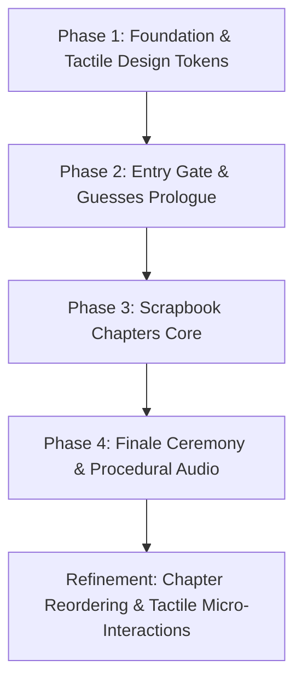

# 📖 Birthday Storybook: Architecture, Chapters & Design Guide

> **Target Audience**: Planning & Designing AI Agents, Frontend Architects, and Visual Designers  
> **Project**: Handcrafted Tactile Birthday Storybook for **Kritika ("Lucky")** (Birthday: 16th October)  
> **Tech Stack**: Vanilla HTML5, Vanilla CSS3 (Custom Properties & Tokens), ES6+ JavaScript, GSAP 3.12 (with Draggable & Timeline), Web Audio API (Procedural Synthesizer), JSON-driven content store  
> **Design Philosophy**: Anti-Template, Tactile Scrapbook, Organic Asymmetry, Mobile-First (360px–430px)

---

## 📑 Table of Contents
1. [Core Creative Vision & Aesthetics](#1-core-creative-vision--aesthetics)
2. [Project Phases & Implementation Progression](#2-project-phases--implementation-progression)
3. [Chapter-by-Chapter Breakdown (Chapters 0 to 6)](#3-chapter-by-chapter-breakdown)
   - [Chapter 0: Cover Gate](#chapter-0-cover-gate-the-sealed-diary)
   - [Chapter 1: Let Me Guess…](#chapter-1-let-me-guess-interactive-deductions)
   - [Chapter 2: Parents](#chapter-2-parents-mom--daddy-vintage-album)
   - [Chapter 3: The OG Opp](#chapter-3-the-og-opp-sisters-wanted-poster--banter)
   - [Chapter 4: Cousins](#chapter-4-cousins-snapshots--air-mail-modal)
   - [Chapter 5: Friends](#chapter-5-friends-corkboard-lightbox--memory-jar)
   - [Chapter 6: Wish! 🎂](#chapter-6-wish--realistic-vibrant-cake--closing-note)
4. [Tactile Design System & Token Specifications](#4-tactile-design-system--token-specifications)
5. [Procedural Audio & Tactile SFX Engine](#5-procedural-audio--tactile-sfx-engine)
6. [Data Contract & Content Architecture](#6-data-contract--content-architecture)
7. [Guidance & Rules for Planning & Designing Agents](#7-guidance--rules-for-planning--designing-agents)

---

## 1. Core Creative Vision & Aesthetics

This project is a bespoke, private digital birthday gift for **Kritika** (fondly called **"Lucky"**), who had to postpone her birthday celebration due to being unwell. 

### Key Tenets for Designers and Planners:
* **Anti-Template Philosophy**: Standard flat UI cards, corporate gradients, and symmetrical SaaS layouts are strictly prohibited. The website must feel like a physical, handcrafted scrapbook personal diary assembled with paper, tape, scissors, Polaroid prints, and dried leaves.
* **Organic Asymmetry**: Elements intentionally lean at wobbly angles (`-6°` to `+6°`). Stickers, washi tape strips, and photo corners hold items onto warm, textured paper backgrounds (`#FFFDF8`, `#FAF5ED`).
* **Tactile Interactions**: Every click or tap has a physical real-world equivalent: breaking a wax seal, stamping rubber ink, peeling washi tape, opening an airmail envelope, reaching into a glass jar, flipping a Polaroid in 3D, and blowing out birthday candles with realistic smoke puffs.
* **Warm, Comforting Atmosphere**: Soft music-box arpeggios, gentle paper rustles, pastel tones (blush pink, creamy vanilla, sage green, lavender, butter yellow), and soothing handwritten typography (`Caveat`, `Gaegu`, `Permanent Marker`, `Lora`).

---

## 2. Project Phases & Implementation Progression

The application was built systematically across 4 strategic phases, followed by a dedicated UX refinement pass:



### Phase 1: Foundation, Tactile Design System & Content Architecture
* **Objective**: Build the application skeleton without external bundler lock-in, define design tokens, procedural SVG paper grain, procedural Web Audio engine, and the book stage navigation engine.
* **Deliverables**:
  - `tokens.css`: Color palette (Rose, Blush, Cream, Sage, Butter, Charcoal Ink), radii, shadows, and easing functions.
  - `typography.css`: Google Fonts integration (`Caveat`, `Gaegu`, `Permanent Marker`, `Courier Prime`, `Lora`, `Outfit`).
  - `scrapbook.css`: Paper grain overlays, washi tape strip variants, photo corners, tilt utility classes (`.tilt-neg-1` through `.tilt-pos-3`).
  - `audio-player.js`: Zero-asset Web Audio API music-box pentatonic synthesizer with procedural paper rustle, sticker pop, page turn, and candle blowout white-noise filters.
  - `book-stage.js`: Chapter slide transitions, bookmark ribbon navigation, touch swipe support, and unlock progression state in `sessionStorage`.
  - `data/content.json` & `content-loader.js`: Modular JSON data architecture with offline fallback.

### Phase 2: The Portal — Entry Gate & "Let Me Guess..." Prologue
* **Objective**: Create the personalized mystery entrance and playful deduction sequence.
* **Deliverables**:
  - `gate.js` & `gate.css`: Sealed diary cover requiring name (`"Kritika"` / `"Lucky"`) and birthday (`16th October`) with witty hint post-its and wax seal break animation.
  - `guess.js` & `guess.css`: 5 deduction flashcards probing her passions (dancing, painting, cakes, blankets), rubber stamp animations (`KNEW IT! ✨`, `DENIAL! 😜`), and celebratory confetti burst.

### Phase 3: The Scrapbook Chapters Core
* **Objective**: Assemble the personal memory chapters from friends, family, sister, and cousins.
* **Deliverables**:
  - Vintage album styling with heirloom photo corners.
  - Playful wanted poster zine layout.
  - Vintage airmail envelopes with postal cancellation stamps.
  - Draggable/flippable Polaroid corkboard.

### Phase 4: Make a Wish Finale, Audio Polishing & Launch Readiness
* **Objective**: Build the celebratory candle ceremony, responsive QA, and unlisted privacy protection.
* **Deliverables**:
  - `finale.js` & `finale.css`: Interactive cake with flickering candle flames, puff blowout, and Prem's closing letter.
  - `robots.txt` (`Disallow: /`) and social OpenGraph tags.
  - Standalone preview server (`serve.js`).

### Refinement Pass: Chapter Reordering & Rich Tactile Overhaul
* **Objective**: Reorder the story to follow a natural emotional crescendo and implement high-tactile components requested by user feedback:
  - Sequence reordered: **Cover → Guesses → Parents → OG Opp → Cousins → Friends → Wish**.
  - **Parents** renamed with dedicated Mom & Daddy cards.
  - **OG Opp** dedicated exclusively to her sister with peelable washi tape confession.
  - **Cousins** transformed into individual photo cards opening a centered **Air Mail letter modal**.
  - **Friends** expanded to **8 enlarged photocards** (no "tap to flip" text) with centered **lightbox focus & 3D flip**, plus an **illustrated glass jar with animated hand reaching in** to draw memories.
  - **Wish** upgraded with a **realistic, vibrant multi-tier artisanal cake** with fresh strawberries, glossy drips, and candlelight glow aura.

---

## 3. Chapter-by-Chapter Breakdown

### Chapter 0: Cover Gate ("Interactive Hero & Sealed Diary")
* **Mount ID**: `#chapter-0` (`data-chapter="gate"`)
* **Controllers**: [`js/hero.js`](file:///c:/Users/premn/birthday_present/js/hero.js), [`js/gate.js`](file:///c:/Users/premn/birthday_present/js/gate.js) | **Styles**: [`css/hero.css`](file:///c:/Users/premn/birthday_present/css/hero.css), [`css/gate.css`](file:///c:/Users/premn/birthday_present/css/gate.css)
* **Narrative Arc**: Mystery, Tactile Engagement & Personalization.
* **Components & Visual Design**:
  - **Closed Journal Initial View**: A vintage rose-leather bound diary on a warm wooden desk surface (`--color-desk`) with gold foil debossing: *"A Secret Storybook • Handcrafted for Kritika ('Lucky')"*.
  - **Unhookable Ribbon Band**: Elastic cloth ribbon holding the book closed. Tapping the charm plays paper rustle audio (`playPaperRustle()`) and unhooks the band.
  - **3D Cover Opening**: The cover rotates open along its spine in 3D perspective (`rotateY(-110deg)` with GSAP timeline) revealing the inside page.
  - **Handwritten Name Field**: As Kritika types her name or nickname, an ink handwriting preview renders her name smoothly.
  - **Hand-drawn October Calendar Date Picker**: An illustrated calendar page where she flips or taps the date. Clicking October 16 triggers an SVG pen stroke circling the date in red ink.
  - **Press-and-Hold Wax Seal**: Instead of a simple click, the user presses and holds the crimson wax seal for 1.2s. An SVG circular progress ring fills while held; early release wobbles and drains; completing the hold plays a crack sound, vibrates haptics, and explodes into 4 GSAP-animated wax shards!
  - **Validation & Hints**: Case-insensitive aliases (`"Kritika"`, `"Lucky"`, `"Kriti"`, `"Kittu"`) + 16th October. Incorrect combinations trigger a gentle seal wobble and a wobbly Post-it note with friendly clues.
* **Navigation Outcome**: Unlocks Chapter 1 and turns page forward.

---

### Chapter 1: Let Me Guess… ("Interactive Deductions")
* **Mount ID**: `#chapter-1` (`data-chapter="guess"`)
* **Controller**: [`js/guess.js`](file:///c:/Users/premn/birthday_present/js/guess.js) | **Styles**: [`css/guess.css`](file:///c:/Users/premn/birthday_present/css/guess.css)
* **Narrative Arc**: Playful Warm-up. Proves we know her quirky habits before revealing the celebration.
* **Components & Visual Design**:
  - 5 flashcards entering from alternating directions with distinct natural tilts (-3deg to +3deg).
  - Sketched reaction arrow (`#doodle-arrow-sketch`) playfully pointing toward the action buttons.
  - Corner washi tapes (`.tape-corner-tl`, `.tape-corner-tr`) anchoring the cards without obscuring text.
  - Rubber stamp badges stamped in tactile ink (*"KNEW IT!"*, *"DENIAL!"*, *"WE HAVE PROOF"*).
  - Soft paper confetti burst on completion.
  - Zero decorative emojis in UI elements.
* **Navigation Outcome**: Unlocks Chapter 2 and navigates to Parents.

---

### Chapter 2: Parents ("Mom & Daddy Heirloom Album")
* **Mount ID**: `#chapter-2` (`data-chapter="parents"`)
* **Controller**: [`js/chapter-parents.js`](file:///c:/Users/premn/birthday_present/js/chapter-parents.js) | **Styles**: [`css/chapters.css`](file:///c:/Users/premn/birthday_present/css/chapters.css)
* **Narrative Arc**: Unconditional Love & Emotional Foundation.
* **Components & Visual Design**:
  - **Unified Heirloom Album Frame**: Antique mounting corners (`.photo-corner`) encasing Mom and Daddy's portraits.
  - **Hand-drawn SVG Portraits**: Handcrafted SVG monogram badges for Mom (`#doodle-portrait-mom`) and Daddy (`#doodle-portrait-daddy`) in torn-paper circles with pressed botanical sprig (`#doodle-leaf-sprig`).
  - **Staggered Handwritten Letter Sheets**: Rather than identical stacked boxes, Mom and Daddy's blessings are rendered on textured stationery sheets with natural tilts and corner washi tapes.
  - Elegant serif typography (`Lora`) with handwritten signatures.
  - Advance button: *"Turn to The OG Opp →"*.
* **Navigation Outcome**: Unlocks Chapter 3 and navigates to OG Opp.

---

### Chapter 3: The OG Opp ("Sister Wanted Poster & Dossier")
* **Mount ID**: `#chapter-3` (`data-chapter="og_opp"`)
* **Controller**: [`js/chapter-og-opp.js`](file:///c:/Users/premn/birthday_present/js/chapter-og-opp.js) | **Styles**: [`css/chapters.css`](file:///c:/Users/premn/birthday_present/css/chapters.css)
* **Narrative Arc**: Sisterhood, Banter & Lifelong Bond.
* **Components & Visual Design**:
  - **Full-page Wanted Poster**: Ripped kraft paper with red dashed border, case file badge (`CASE FILE #1016-OPP`), and bold lettering for sister Riya.
  - **Sister Snapshot Doodle**: Hand-drawn SVG doodle (`#doodle-sister-snap`) in a tilted Polaroid frame with caption *"Roommates by blood, rivals by choice"*.
  - **Crimes Dossier**: Typewriter monospace list of infractions (hoodie theft, midnight dance concerts, frosting robbery).
  - **Peelable Washi Tape Confession**: An interactive tape strip covering her sister's heartfelt message. Tapping peels the tape upward and reveals the touching confession and verdict stamp: `VERDICT: BEST SISTER FOR LIFE`.
  - Advance button: *"Turn to Cousin Air Mail →"*.
* **Navigation Outcome**: Unlocks Chapter 4 and navigates to Cousins.

---

### Chapter 4: Cousins ("Organic Scattered Postcards & Air Mail")
* **Mount ID**: `#chapter-4` (`data-chapter="cousins"`)
* **Controller**: [`js/chapter-cousins.js`](file:///c:/Users/premn/birthday_present/js/chapter-cousins.js) | **Styles**: [`css/chapters.css`](file:///c:/Users/premn/birthday_present/css/chapters.css)
* **Narrative Arc**: Shared Roots & Family Adventures.
* **Components & Visual Design**:
  - **Organic Scattered Postcards**: Asymmetrical scattered layout with overlapping cards, natural tilts (-3deg to +3.5deg), and varied heights (Aarav, Simran, Kabir, Diya). Not a stiff grid.
  - **Miniature Stamps & Postmarks**: Each card features a miniature postal stamp with handcrafted SVG doodle (`#doodle-beach`, `#doodle-dance`, `#doodle-pizza`, `#doodle-pottery`) and circular `PAR AVION` postmark.
  - **Air Mail Modal Overlay**: Tapping any cousin's postcard opens an authentic Air Mail envelope modal:
    * Red and blue diagonal chevron stripes (*PAR AVION*).
    * Circular postmark stamp with date cancellation: `OCT 16`.
    * Unfolded lined stationery sheet with personal message and signoff.
    * Tactile `Close Letter ✕` button.
  - Advance button: *"Turn to Friends Corkboard →"*.
* **Navigation Outcome**: Unlocks Chapter 5 and navigates to Friends.

---

### Chapter 5: Friends ("Real Corkboard, Pushpins & Memory Jar")
* **Mount ID**: `#chapter-5` (`data-chapter="friends"`)
* **Controller**: [`js/chapter-friends.js`](file:///c:/Users/premn/birthday_present/js/chapter-friends.js) | **Styles**: [`css/chapters.css`](file:///c:/Users/premn/birthday_present/css/chapters.css)
* **Narrative Arc**: Everyday Laughs & Soul Circle.
* **Components & Visual Design**:
  - **Real Corkboard Frame**: Textured cork background with wooden border and subtle red string overlay connecting besties across the board.
  - **Pushpin Mounting**: Pushpins (`#doodle-pushpin`) instead of tape for all 8 friend photocards (Ananya, Rohan, Meera, Priya, Dev, Sneha, Tanvi, Arjun).
  - **Hand-drawn SVG Doodles**: Camera, Paintbrush, Cake Slice, Teacup, Headphones, Sparkle, Dance, Sunset.
  - **Centered Lightbox Zoom & 3D Flip**: Tapping any card focuses and enlarges the Polaroid in a centered modal. Tapping the enlarged card triggers a 3D flip (`rotateY(180deg)`) revealing the handwritten letter on lined paper.
  - **Realistic Glass Memory Jar**:
    * Rendered mason jar with cork stopper, twine string, glass reflections, and colorful paper slips inside.
    * Animated reaching hand (`#animated-hand`) that reaches into the jar and draws out a folded note with rustle SFX.
    * Unfolded note modal displays personal shared memories.
  - Advance button: *"Turn to Make a Wish →"*.
* **Navigation Outcome**: Unlocks Chapter 6 and navigates to Finale.

---

### Chapter 6: Wish! ("Grand Artisanal Cake, Bunting & Blowout Ceremony")
* **Mount ID**: `#chapter-6` (`data-chapter="finale"`)
* **Controller**: [`js/chapter-finale.js`](file:///c:/Users/premn/birthday_present/js/chapter-finale.js) | **Styles**: [`css/finale.css`](file:///c:/Users/premn/birthday_present/css/finale.css)
* **Narrative Arc**: Climax, Celebration & Emotional Closure.
* **Components & Visual Design**:
  - **Paper Bunting Garland**: Colorful celebratory bunting flags strung across the top of the page.
  - **Scaled-Up Cake**: Expanded to dominate mobile viewport (320px width), with glazed ceramic pedestal and wooden table surface underneath.
  - **Candles Lit First**: 3 realistic spiral candles with teardrop flickering flames and ambient candlelight glow aura.
  - **Closing Letter Strictly Hidden**: Prem's letter card is 100% hidden until candles are blown out.
  - **Interactive Blowout Ceremony**:
    * Tap individual candles or tap *"Blow Out All Candles"*.
    * Realistic rising smoke puffs curl upward.
    * Confetti shower erupts across the screen for under 4 seconds.
    * Prem's closing letter unfolds with a heartfelt message.
  - **Passport Stamps & Replay**:
    * Action button to view the collected passport stamps booklet.
    * *"Replay from Cover ↺"* button for smooth re-reading.

---

## 4. Tactile Design System & Token Specifications

All design tokens are centralized in [`css/tokens.css`](file:///c:/Users/premn/birthday_present/css/tokens.css):

### Color Palette (Tailored HSL & Hex)
| Token Name | Value | Purpose |
|------------|-------|---------|
| `--color-paper-warm` | `#FFFDF8` | Base diary page background |
| `--color-paper-cream`| `#FAF5ED` | Slightly aged stationery & cards |
| `--color-paper-aged` | `#F3EBE0` | Polaroid photo backings & borders |
| `--color-desk`        | `#EFE7DA` | Desk surface beneath the journal |
| `--color-rose`        | `#F4C2C7` | Primary accent, wax seal, ribbons |
| `--color-rose-deep`   | `#D98A9B` | High-contrast headers & stamps |
| `--color-blush`       | `#FAD2E1` | Soft highlights & tape strips |
| `--color-sage`        | `#B7C9A8` | Botanical leaves, nature accents |
| `--color-butter`      | `#F7E3A1` | Post-it notes & warm stickers |
| `--color-lavender`    | `#CDB8E3` | Cousin stamps & tape strips |
| `--color-ink`         | `#3A2F32` | Charcoal handwriting ink (never pure black) |
| `--color-ink-muted`   | `#68595D` | Secondary captions & dates |
| `--color-red`         | `#C8483F` | Wanted poster & alert stamps |

### Typography Stack
| Font Family | CSS Variable / Class | Role |
|-------------|----------------------|------|
| **Caveat** | `'Caveat', cursive` / `.font-handwriting` | Personal letters, captions, handwritten signatures |
| **Gaegu** | `'Gaegu', cursive` | Playful UI prompts, sticky notes, buttons |
| **Permanent Marker**| `'Permanent Marker', cursive` | Rubber stamps, wanted poster, chapter tags |
| **Courier Prime** | `'Courier Prime', monospace` / `.font-typewriter` | Case files, airmail postmarks, postal data |
| **Lora** | `'Lora', serif` | Deep emotional letters (Mom & Daddy, Prem's note) |
| **Outfit** | `'Outfit', sans-serif` | Clean legible UI labels and form tabs |

### Tactile Shadows & Physical Skeuomorphism
```css
--shadow-paper: 0 2px 6px rgba(74, 59, 63, 0.08), 0 8px 18px rgba(74, 59, 63, 0.06);
--shadow-paper-deep: 0 4px 12px rgba(74, 59, 63, 0.12), 0 16px 32px rgba(74, 59, 63, 0.08);
--shadow-tape: 0 1px 3px rgba(74, 59, 63, 0.18);
--shadow-polaroid: 0 4px 12px rgba(74, 59, 63, 0.15), 0 1px 3px rgba(74, 59, 63, 0.1);
--shadow-lifted: 0 12px 28px rgba(74, 59, 63, 0.22);
```

### Wobbly Angles & Tilts
Cards never lay completely straight. The design system uses pre-calibrated rotational utilities:
* `.tilt-neg-1`: `-1.5deg` | `.tilt-pos-1`: `+1.5deg`
* `.tilt-neg-2`: `-3deg`   | `.tilt-pos-2`: `+2.8deg`
* `.tilt-pos-3`: `+4.2deg`

---

## 5. Procedural Audio & Tactile SFX Engine

Located in [`js/audio-player.js`](file:///c:/Users/premn/birthday_present/js/audio-player.js). **Requires zero MP3/WAV audio assets**, synthesized live using the Web Audio API:

1. **Music-Box Lofi Arpeggios**:
   - Synthesizes pure sine waves with exponential decay envelopes on pentatonic notes: $C_4, D_4, E_4, G_4, A_4, C_5, D_5, E_5$ ($261.63\text{ Hz} \to 659.25\text{ Hz}$).
   - Plays peaceful, slow tempo loops with soft sub-bass root notes.
2. **Tactile Sound Effects**:
   - `playPaperRustle()`: Filtered white noise with bandpass modulation ($800\text{ Hz} \to 1800\text{ Hz}$) mimicking crisp stationery rubbing.
   - `playStickerPop()`: Dual-pitch sine blip ($520\text{ Hz} \to 880\text{ Hz}$) mimicking wax cracking or sticker peeling.
   - `playPageTurn()`: Gentle low-frequency swish ($300\text{ Hz} \to 700\text{ Hz}$).
   - `playCandleBlow()`: Breath noise through low-pass envelope ($400\text{ Hz}$).
3. **User Control**:
   - Muted by default with an accessible status indicator (`#audio-toggle-btn`) in the header.

---

## 6. Data Contract & Content Architecture

All dynamic content is strictly decoupled into [`data/content.json`](file:///c:/Users/premn/birthday_present/data/content.json). This guarantees anyone can customize text and photos without editing JavaScript or CSS:

```json
{
  "recipient": {
    "displayName": "Kritika",
    "nickname": "Lucky",
    "acceptedNames": ["kritika", "lucky", "kriti", "kittu"],
    "birthday": { "day": 16, "month": 10 },
    "interests": ["dancing", "painting", "cakes", "tea", "blankets"]
  },
  "guesses": [ /* 5 clue objects */ ],
  "chapters": [
    { "id": "gate", "index": 0, "tabTitle": "Cover" },
    { "id": "guess", "index": 1, "tabTitle": "Guesses" },
    { "id": "parents", "index": 2, "tabTitle": "Parents", "entries": [ /* Mom, Daddy */ ] },
    { "id": "og_opp", "index": 3, "tabTitle": "OG Opp", "sisterName": "...", "wantedCrimes": [ ... ], "confession": "..." },
    { "id": "cousins", "index": 4, "tabTitle": "Cousins", "entries": [ /* 4 cousins */ ] },
    { "id": "friends", "index": 5, "tabTitle": "Friends", "entries": [ /* 8 friends */ ], "memoryJarNotes": [ ... ] },
    { "id": "finale", "index": 6, "tabTitle": "Make a Wish", "closingLetter": { ... } }
  ]
}
```

---

## 7. Guidance & Rules for Planning & Designing Agents

When planning new features, styling enhancements, or adding new memory cards, follow these strict directives:

1. **Maintain Linear Unlock Progression**:
   - The user must never be overwhelmed with all chapters unlocked initially. The story unlocks sequentially:
     `Cover (0) → Guesses (1) → Parents (2) → OG Opp (3) → Cousins (4) → Friends (5) → Wish (6)`.
   - In development/debugging, use `?preview=all` to unlock all chapters immediately via URL parameter.

2. **Respect the Anti-Template Aesthetic**:
   - Do **NOT** use bootstrap-style modals, generic alert boxes, or standard square cards.
   - Always wrap photos in Polaroid borders, antique corners, or postage stamps.
   - Always anchor cards with a washi tape strip (`.washi-tape-pink`, `.washi-tape-sage`, `.washi-tape-butter`, or `.washi-tape-lavender`).
   - Use organic tilt angles (`.tilt-neg-1`, `.tilt-pos-1`, `.tilt-pos-2`, etc.).

3. **Performance & Zero Bundler Guarantee**:
   - Keep the project running purely with static HTML/CSS/JS. Do not introduce Webpack, Vite, or npm bundle dependencies unless explicitly requested.
   - All animations must utilize GPU-accelerated CSS properties (`transform`, `opacity`) or lightweight GSAP tweens.

4. **Mobile First & Accessibility**:
   - Design for iPhone/Android viewports (360px–430px) as the primary screen.
   - Ensure all tap targets are at least `44px × 44px`.
   - Never disable `prefers-reduced-motion` fallbacks; respect user accessibility preferences.
   - Use high-contrast ink (`#3A2F32`, `#68595D`, `#C8483F`) against cream/paper backgrounds to ensure readability.

5. **Audio Etiquette**:
   - Never autoplay audio with sound unmuted on initial load; always require explicit user opt-in via `#audio-toggle-btn`.

---

## 8. Mobile & Desktop Responsive Architecture

The storybook implements a dual-mode responsive layout: **tactile single-column scroll on mobile** (360px–430px) and an **authentic two-page scrapbook journal spread on desktop** (768px–1920px).

### 📱 Mobile Experience (360px–430px, Primary Target)
- **Spine & Navigation**: The center fold line (`.journal-spine`) and bottom navigation bar (`.journal-nav-bar`) are completely removed (`display: none !important;`). Progression is guided naturally by tactile in-page CTA stamps (*"Turn to..."*).
- **Zero Horizontal Overflow**: All grids use fluid minmax definitions (`grid-template-columns: repeat(7, minmax(0, 1fr))` for calendar days, `width: min(310px, calc(100vw - 36px))` for cake wrapper, `width: min(330px, calc(100vw - 28px))` for wooden tabletop).
- **Touch Target Compliance**: All buttons, reaction stamps, audio toggles, and photo cards have tap targets ≥ `44px × 44px`.
- **Chapter Layouts on Mobile**:
  - *Cover Gate*: Single-column stacked input, calendar picker, and wax seal button.
  - *Parents*: Compact heirloom frame with circular portraits and vertically stacked letter sheets.
  - *OG Opp*: Centered wanted poster with responsive padding and full-width peelable tape.
  - *Cousins*: 2-column organic postcard grid with subtle tilts (1-column on ≤360px).
  - *Friends Corkboard*: 2-column photo grid with pushpins and spanning red string (1-column on ≤360px).
  - *Make a Wish Finale*: Cake scaled cleanly (`scale(0.92)` on ≤440px, `scale(0.85)` on ≤360px) preventing any viewport clipping.

### 💻 Desktop Experience (768px–1920px, Two-Page Journal Spread)
- **Journal Dimensions**: The scrapbook expands up to `960px` (≥768px) and `1040px` (≥1200px) with subtle page shadows.
- **Center Spine Fold**: A subtle 32px vertical fold line is centered at `50%` (`opacity: 0.04; z-index: 0; pointer-events: none;`) mimicking an open hardcover journal.
- **Two-Page Multi-Column Layouts**:
  - *Cover Gate*: 2-column spread (Left: Name input + ink calligraphy; Right: Hand-drawn calendar picker; Bottom: Centered wax seal).
  - *Parents*: 2-column letter spread (Mom's letter on the left page, Daddy's letter on the right page) below the heirloom frame.
  - *OG Opp*: Centered wanted poster (up to 520px) with rich layered drop shadows.
  - *Cousins*: 4-column organic postcard spread across both pages with staggered tilts.
  - *Friends Corkboard*: 4-column × 2-row pinboard layout spanning 8 bestie Polaroids with red string connecting pins.
  - *Make a Wish Finale*: Grand cake presentation with expanded wooden table surface (440px), bunting garland (540px), and wide closing letter card (660px).
